# Diseño de la base de datos (Semana 9)

Base de datos local **SQLite** (paquete `sqflite`), archivo `la_mesa_dorada.db`, **versión 2**.
La versión 2 agrega el módulo de cocina; quien ya tenía la app instalada se actualiza sola (migración en `onUpgrade`) sin perder pedidos.
Se crea y se llena con los datos del prototipo la primera vez que se abre la app
(`lib/data/database/database_helper.dart`).

```mermaid
erDiagram
    CATEGORIAS ||--o{ PRODUCTOS : contiene
    PEDIDOS ||--|{ PEDIDO_ITEMS : incluye
    PRODUCTOS ||--o{ PEDIDO_ITEMS : "se pide en"
    CODIGOS_PROMOCIONALES |o--o{ PEDIDOS : "se aplica a"

    CATEGORIAS {
        TEXT id PK "hamburguesas, pizzas..."
        TEXT nombre
        INTEGER orden
    }
    PRODUCTOS {
        TEXT id PK "triple_carne..."
        TEXT categoria_id FK
        TEXT nombre
        TEXT nombre_completo
        TEXT descripcion_corta
        TEXT descripcion
        INTEGER precio "COP"
        INTEGER stock "0 = SOLD OUT, nunca negativo"
        TEXT ingredientes "separados por |"
        INTEGER habilitado "0 = la cocina lo marcó no disponible"
        INTEGER activo "0 = oculto del menú"
        TEXT imagen_url "foto opcional"
    }
    PEDIDOS {
        INTEGER id PK
        INTEGER fecha "epoch ms"
        INTEGER subtotal
        INTEGER descuento
        INTEGER envio "siempre 0 (autoservicio)"
        INTEGER total
        TEXT codigo_promocional
        TEXT tipo_entrega "comer_aqui | para_llevar"
        TEXT estado "recibido | en_preparacion | listo | entregado"
        INTEGER actualizado "último cambio de estado"
    }
    PEDIDO_ITEMS {
        INTEGER id PK
        INTEGER pedido_id FK
        TEXT producto_id
        TEXT nombre "copia al momento del pedido"
        INTEGER precio_unitario
        INTEGER cantidad
    }
    CODIGOS_PROMOCIONALES {
        TEXT codigo PK
        TEXT tipo "porcentaje | valor"
        INTEGER valor
        INTEGER activo
    }
    USUARIOS {
        INTEGER id PK
        TEXT usuario "único"
        TEXT nombre
        TEXT rol "cocina"
        TEXT hash "SHA-256 x10000, nunca texto plano"
        TEXT sal "aleatoria por usuario"
        INTEGER intentos_fallidos
        INTEGER bloqueado_hasta "epoch ms"
    }
    RESENAS {
        INTEGER id PK
        INTEGER estrellas "1 a 5"
        TEXT comentario
        INTEGER fecha
    }
```

## Decisiones

- **Precios en enteros (pesos):** el peso colombiano no usa centavos en la práctica; se evitan errores de redondeo.
- **`pedido_items` guarda nombre y precio:** si después cambia el menú, el historial del pedido no se altera.
- **Stock en `productos`:** al realizar un pedido se verifica y descuenta dentro de una **transacción**; si otro pedido agotó el producto, se avisa al usuario y no se guarda nada a medias.
- **Autoservicio:** el `id` del pedido es el **número de turno** que se muestra al cliente; `tipo_entrega` guarda si come en el local o lo lleva. No hay envío a domicilio.
- **Estado del pedido guardado:** la cocina lo cambia desde su panel (`pedidos.estado`); el cliente ve el cambio y recibe la notificación.
- **Disponibilidad:** un producto se puede pedir solo si `activo = 1`, `habilitado = 1` y `stock > 0`.
- **Contraseñas:** se guarda `hash` + `sal`, nunca la contraseña. Tras 5 intentos fallidos se llena `bloqueado_hasta` (5 minutos).
- **Repositorios:** las pantallas nunca usan SQL directamente; pasan por `CatalogoRepository` y `PedidoRepository`. Para migrar a un servidor solo se reemplazan esas clases.

## Códigos promocionales de prueba

| Código | Descuento |
|---|---|
| `MESA10` | 10 % |
| `DORADA20` | 20 % |
| `BIENVENIDO` | $5.000 |
